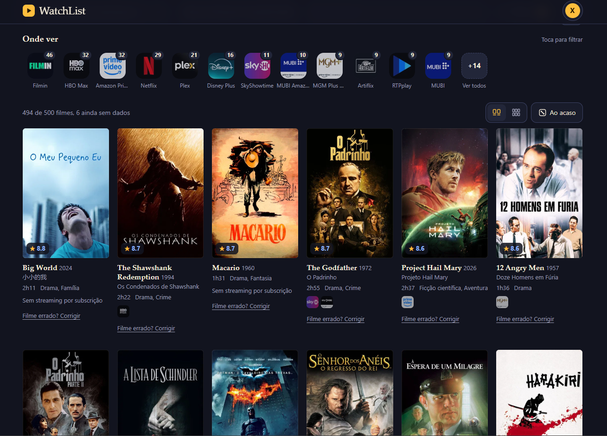
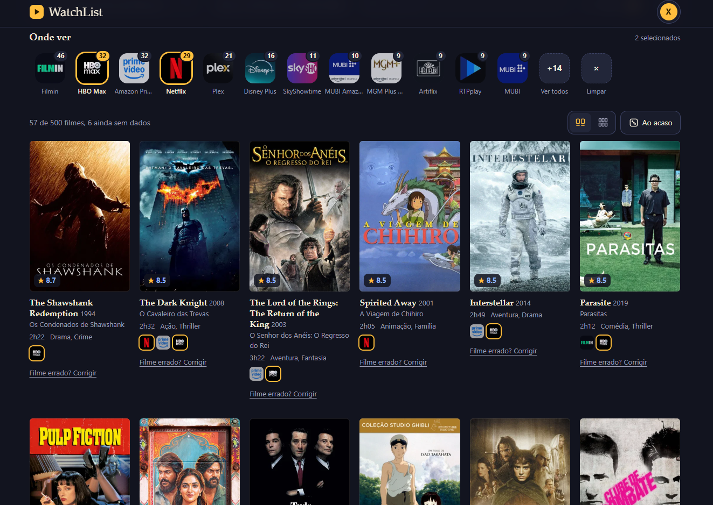
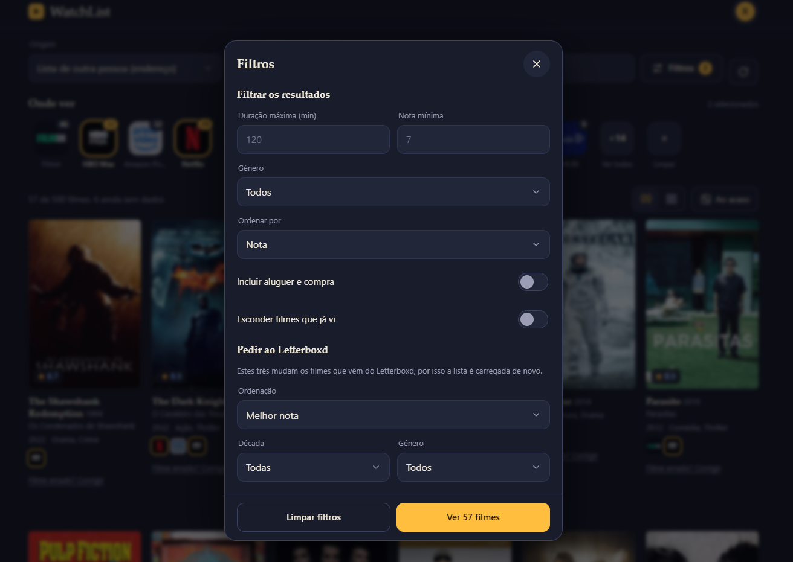

# WatchList

Uma alternativa gratuita ao filtro por serviço de streaming do Letterboxd Pro.

O Letterboxd Pro permite filtrar listas pelos serviços onde os filmes estão disponíveis, mas é uma feature que faz parte do plano pago. Esta app faz o mesmo de graça: lê as listas do Letterboxd e cruza-as com os dados do TMDB/JustWatch, permitindo fazer uma seleção entre os catálogos dos vários serviços de streaming em Portugal.

<div align="center">

### Página Inicial
  
  
### Serviços de Streaming selecionados
  

### Filtros
  

</div>

## O que faz

- Lê a watchlist, os filmes com gosto, já vistos, listas do utilizador e listas de outras pessoas.
- Filtra por serviço de streaming (Netflix, Max, Prime Video, etc.).
- Filtra por duração, nota, género e já vistos, e ordena como no Letterboxd.
- Feature de selecionar aleatoriamente.
- Funciona no telemóvel e pode ser instalada no ecrã principal (PWA).

## Como funciona

Uma app estática e um pequeno proxy num Cloudflare Worker (grátis), que lê as páginas públicas do Letterboxd. O Worker não guarda nada: a sessão e a chave do TMDB ficam só no teu dispositivo.

```
telemóvel ──► Cloudflare Worker ──► letterboxd.com
     └──────► api.themoviedb.org
```

## Instalar

Node.js 18+
Conta gratuita na [Cloudflare](https://dash.cloudflare.com)
Chave gratuita do [TMDB](https://www.themoviedb.org/settings/api) (o "API Read Access Token").

```bash
git clone https://github.com/davdoliveira/watchlist.git
cd watchlist
npm install
npx wrangler login
npx wrangler secret put ACCESS_KEY   # uma chave tua, para ninguém usar o teu proxy
npm run deploy
```

Abre o endereço que aparece no fim, toca no ícone da conta, cola a chave do TMDB e a chave de acesso, e liga o teu Letterboxd (utilizador e password, cookie, ou só o nome de um perfil público). Para instalar no telemóvel, usa "Adicionar ao ecrã principal" no menu do Chrome ou do Safari.

## Testes

```bash
npm test
```

## Limitações

- Lê o HTML público do Letterboxd, por isso pode deixar de funcionar se o site mudar ou bloquear o Worker.
## Créditos

Este produto usa a API do TMDB mas não é endossado nem certificado pelo TMDB. Dados de streaming do JustWatch, via TMDB. Projeto independente, sem ligação ao Letterboxd.

## Licença

[MIT](LICENSE)
